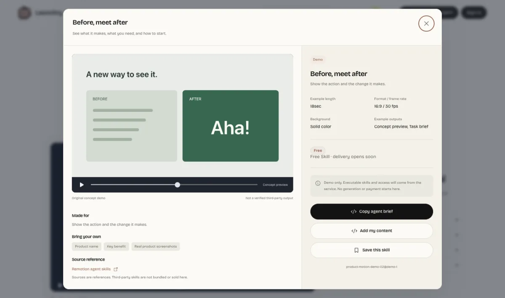

# Awesome Fable 5.2 Videos

A collection for videos made with **Claude Fable 5.2**, with creator credits, prompts and editable source where available. [Official model announcement](https://www.anthropic.com/claude-fable-and-mythos-5-2)

**[▶ Explore product launch videos and try a free demo on Launchry](https://launchry.dev/?lang=en&utm_source=github&utm_medium=readme&utm_campaign=awesome-fable-5-2-videos&resource=product-motion-demo-02&utm_content=featured_demo)**

The collection is open for submissions. The first videos and prompts are pending. See the [video index](data/videos.json) and [prompt folder](prompts/).

## Contents

- [Motion graphics](#motion-graphics)
- [Explainers](#explainers)
- [3D scenes](#3d-scenes)
- [Games & interactive](#games--interactive)
- [Latest prompts](#latest-prompts)
- [How to use a prompt](#how-to-use-a-prompt)
- [Free Skills](#free-skills)
- [Submit a video](#submit-a-video)
- [Credits](#credits)

## Motion graphics

<!-- Add video cards here. Each card links to a preview, creator, and prompt or original post. -->

## Explainers

<!-- Add explainer video cards here. -->

## 3D scenes

<!-- Add 3D scene video cards here. -->

## Games & interactive

<!-- Add games and interactive video cards here. -->

## Latest prompts

Published prompts will appear in [`prompts/`](prompts/).

## How to use a prompt

1. Open a prompt file and copy the text under **Prompt**.
2. Give it to a coding agent running Claude Fable 5.2, with your own screenshots, recordings or other assets.
3. Ask for the editable project and a rendered video.

## Free Skills

- **HyperFrames Launch Teaser.** Make a 12-second feature reveal with a before-and-after shot and one call to action. [Download the free Skill](https://github.com/SnapSnap-LLC/awesome-gpt-6-2-sol-videos/releases/download/starter-v1/hyperframes-launch-teaser.zip)
- **Remotion.** Make videos with React using the [official Remotion Skill](https://github.com/remotion-dev/skills/tree/main/skills/remotion-best-practices).

[Browse more video Skills on Launchry](https://launchry.dev/?lang=en&utm_source=github&utm_medium=readme&utm_campaign=awesome-fable-5-2-videos&utm_content=free_skills).

## Submit a video

[Open a submission](https://github.com/SnapSnap-LLC/awesome-fable-5-2-videos/issues/new?template=submit-video.yml) with the video, creator link and evidence that Claude Fable 5.2 was used. Add the prompt or editable source if the creator shared it.

## Credits

The gallery format follows [Awesome Opus 5.5 Videos](https://github.com/yihui-dev/awesome-opus5-5-videos). The screenshot shows a Launchry concept demo. Contributors retain rights to their own videos and prompts.
